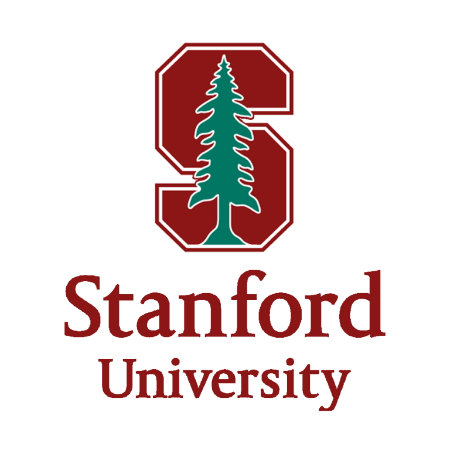
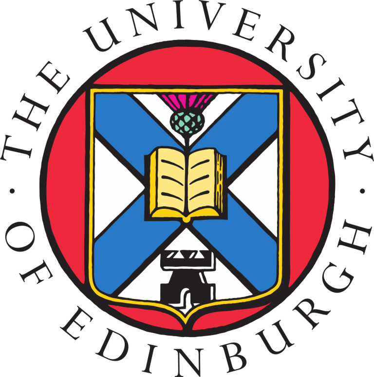

### **Graduate Student**

PhD in Economics, Fall 2022–Anticipated 2028. Committee members:
* [__Nicholas Bloom__](https://nbloom.people.stanford.edu/)
* [Liran Einav](https://leinav.people.stanford.edu/)
* [Isaac Sorkin](https://sites.google.com/site/isaacsorkin/home)
* [Shoshana Vasserman](https://shoshanavasserman.com/)

See my [Teaching](teaching.html) page for courses, evaluations, and mentoring.

### Service:
* Co-Organizer, Applied Lunch Seminar (Fall 2024- Spring 2025)
* Founding Co-Organizer, Applied Job Market Showcase (Fall 2024)
* Member, Economics Graduate Student Council (Fall 2022-Spring 2024)

### **A. B., Economics and Mathematics, Minor in Computer Science**

Class of 2019, advised by [John Fitzgerald](https://www.bowdoin.edu/profiles/faculty/jfitzger/index.html).

&nbsp;

### **Visiting Student**

Visited Spring of 2018